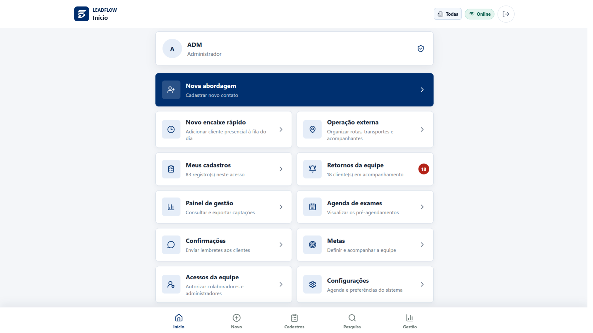
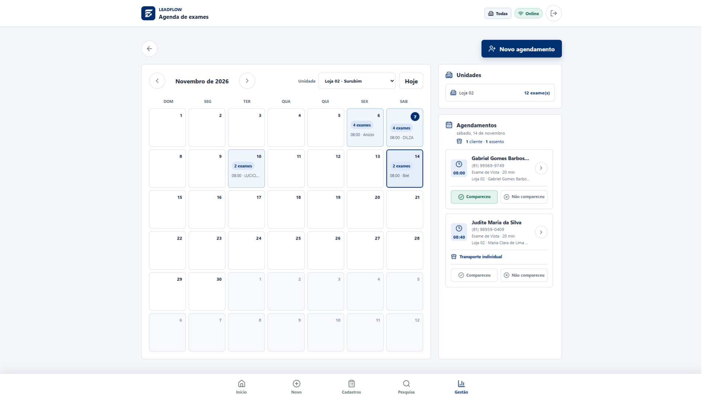

<p align="center">
  
</p>

<p align="center">
  <a href="https://github.com/GabrielBarbosa0/LEADFLOW/releases/tag/v0.1.0"></a>
  
  
  
</p>

# LeadFlow

O **LeadFlow** e uma Progressive Web App para captacao, agendamento e
acompanhamento operacional de clientes das **Oticas Fascinante**. O sistema
substitui fichas em papel por um fluxo digital responsivo, instalavel e preparado
para equipes externas, colaboradores internos, gestores e administradores.

A aplicacao centraliza o cadastro do cliente, a disponibilidade da agenda, a
operacao de transporte, os retornos e os indicadores de desempenho sem perder a
capacidade de trabalhar em locais com conexao instavel.

> **Versao oficial em producao:**
> [`v0.1.0`](https://github.com/GabrielBarbosa0/LEADFLOW/releases/tag/v0.1.0)

## Interface

### Inicio



### Agenda de exames



## Principais destaques

- **Operacao offline controlada:** permite captar e preservar dados no aparelho
  quando uma loja estiver autorizada a trabalhar sem conexao.
- **Agenda com reserva por blocos:** considera servicos, duracao, expediente,
  escalas, cotas e compartilhamento de recursos entre unidades.
- **Permissoes granulares:** cada perfil recebe apenas as unidades, telas e acoes
  necessarias para sua funcao.
- **Gestao operacional completa:** dashboards, filtros, exportacao, metas,
  ranking, retornos e acompanhamento por unidade e colaborador.
- **PWA responsiva:** funciona no navegador e pode ser instalada em celulares e
  computadores.
- **Seguranca em duas camadas:** autenticacao pelo Firebase e autorizacao
  aplicada pelas Security Rules do Firestore.

## Funcionalidades

### Captacao e cadastro

- cadastro de clientes com dados pessoais, endereco, estrategia e interesse;
- consulta de CEP quando existe conexao, mantendo preenchimento manual offline;
- triagem para encaminhamento a optometrista ou oftalmologista;
- registro de exame pago ou cortesia, transporte e acompanhantes;
- selecao de unidade, servico, data e horario disponiveis;
- verificacao de agendamento ativo por CPF;
- historico do lead com eventos e responsaveis;
- transferencia de responsabilidade entre colaboradores autorizados;
- pesquisa e filtros por nome, telefone, unidade e periodo.

### Agenda e atendimento

- calendario mensal por unidade;
- servicos com duracoes diferentes e reserva atomica dos horarios;
- escalas, expedientes e limites configuraveis por loja;
- agendas compartilhadas entre unidades que utilizam o mesmo recurso;
- marcacao de comparecimento ou falta sem perder a posicao da lista;
- reagendamento, cancelamento e registro dos motivos;
- confirmacoes individuais por WhatsApp, sempre iniciadas manualmente;
- fila de retornos para faltas e agendamentos pendentes;
- encaixe rapido para clientes presenciais.

### Operacao externa

- visao diaria dos clientes com transporte;
- controle de acompanhantes e quantidade de assentos;
- filtros por data, unidade, transporte e acompanhamento;
- busca por cliente ou localizacao;
- organizacao da operacao sem alterar a agenda de exames.

### Gestao e equipe

- dashboard com indicadores de captacao, agendamento e comparecimento;
- desempenho por unidade e ranking de captadores;
- metas individuais de captacao e acompanhamento da equipe;
- estatisticas de perfil, estrategia, interesse, transporte e pagamentos;
- analise de cancelamentos, reagendamentos e patologias informadas;
- exportacao detalhada para CSV;
- administracao de acessos, cargos e unidades permitidas;
- configuracao de servicos, agenda, escalas e preferencias por loja.

## Operacao offline

O modo offline e uma capacidade controlada por loja. Quando habilitado, o
LeadFlow permite criar o cadastro sem internet e o apresenta imediatamente em
**Meus cadastros** como aguardando agendamento.

Os dados permanecem no armazenamento persistente do Firestore no navegador e
sao sincronizados quando a conexao retorna. Cada registro utiliza um
identificador criado no dispositivo para que novas tentativas nao gerem
duplicidade.

Data e horario nao sao reservados offline. A agenda depende de uma resposta
atual do servidor para evitar conflitos de horario, ultrapassar cotas ou usar
uma escala desatualizada. O selo de conectividade e apenas um indicador visual;
operacoes criticas aguardam confirmacao real do Firebase.

## Perfis e autorizacao

| Perfil | Escopo principal |
| --- | --- |
| Colaborador Externo | Captacao, propria carteira, retornos, metas e operacao externa |
| MEI | Operacao externa com unidades, dias e cotas configuraveis |
| Colaborador Interno | Cadastro, agenda, comparecimento, encaixes e rotinas internas |
| Gestor | Unidades permitidas, equipe, indicadores, agenda, metas e exportacoes |
| Administrador | Acesso global, configuracoes, cargos, unidades e administracao do sistema |

Os perfis podem receber permissoes personalizadas. Ocultar uma acao na
interface nao e considerado controle de seguranca: as permissoes tambem sao
validadas pelas regras do Firestore e pelas funcoes protegidas.

## Arquitetura

```text
Celular ou navegador
  |
  |-- Vite + JavaScript ES Modules
  |-- PWA + Service Worker
  |-- Cache persistente do Firestore em IndexedDB
  |
  |---> Hostinger
  |       `-- frontend estatico em HTTPS
  |
  `---> Firebase
          |-- Authentication
          |-- Cloud Firestore
          |-- Security Rules
          `-- Callable Functions protegidas
```

### Tecnologias

- HTML5, CSS3 e JavaScript moderno;
- Vite;
- Firebase Authentication, Firestore e Functions;
- Firebase Emulator Suite;
- PWA, Web App Manifest e Service Worker;
- Lucide Icons;
- Vitest e Firebase Rules Unit Testing;
- Playwright;
- Hostinger para o frontend estatico de producao.

## Integracoes

### SavWin local

O ambiente de desenvolvimento possui um proxy local e somente leitura para
consultas autorizadas ao SavWin. As credenciais permanecem no processo Node e
nao sao enviadas ao navegador nem fazem parte do build publicado na Hostinger.

O contrato esta documentado em
[`docs/savwin-local-proxy.openapi.yaml`](docs/savwin-local-proxy.openapi.yaml).

### CRM

O LeadFlow **nao possui integracao com CRM em producao atualmente**. O
repositorio contem um contrato de API somente leitura e uma implementacao local
que servem como base tecnica para uma possivel integracao futura.

Publicar essa API exigira uma decisao especifica sobre infraestrutura,
autenticacao por parceiro, auditoria, limite de requisicoes, protecao de
segredos e custos. Essa preparacao nao transforma o LeadFlow em um CRM e nao
envia dados para sistemas externos na operacao atual.

Consulte [`docs/fascinlead-api.openapi.yaml`](docs/fascinlead-api.openapi.yaml)
e [`docs/API-CATALOG.md`](docs/API-CATALOG.md) para conhecer essa fronteira.

## Seguranca e privacidade

- acesso permitido somente a contas cadastradas e ativas;
- autorizacao por perfil, permissao e unidade;
- regras do Firestore testadas no emulador;
- isolamento dos registros conforme o alcance de cada usuario;
- ausencia de credenciais administrativas no frontend;
- minimizacao de dados pessoais e sensiveis;
- nenhuma informacao pessoal em URLs ou logs tecnicos;
- HTTPS obrigatorio em producao;
- scripts administrativos em modo `dry-run` por padrao.

## Documentacao

| Documento | Conteudo |
| --- | --- |
| [`AGENTS.md`](AGENTS.md) | Regras permanentes para manutencao do repositorio |
| [`docs/TDD.md`](docs/TDD.md) | Arquitetura, requisitos, modelo de dados e decisoes tecnicas |
| [`docs/API-CATALOG.md`](docs/API-CATALOG.md) | Catalogo de APIs, funcoes e integracoes |
| [`docs/PERMISSOES-FIREBASE.md`](docs/PERMISSOES-FIREBASE.md) | Modelo de permissoes e operacao no Firebase |
| [`docs/HOSTINGER.md`](docs/HOSTINGER.md) | Publicacao e diagnostico do frontend em producao |
| [`docs/PLANO-INTEGRACAO-SAVWIN-E-METAS.md`](docs/PLANO-INTEGRACAO-SAVWIN-E-METAS.md) | Descoberta da API SavWin, arquitetura n8n e evolucao planejada das metas |
| [`docs/MATRIZ-PERFIS-E-FLUXOS-HOMOLOGACAO.md`](docs/MATRIZ-PERFIS-E-FLUXOS-HOMOLOGACAO.md) | Matriz de perfis e fluxos de validacao |
| [`docs/DADOS-HOMOLOGACAO-LOCAL.md`](docs/DADOS-HOMOLOGACAO-LOCAL.md) | Dados ficticios e preparacao do ambiente local |

## Desenvolvimento local

### Requisitos

- Node.js 20.19 ou superior;
- npm 10 ou superior;
- Java para a Firebase Emulator Suite;
- Firebase CLI para testes de regras e operacoes administrativas.

### Instalacao

```bash
git clone https://github.com/GabrielBarbosa0/LEADFLOW.git
cd LEADFLOW
npm install
```

Copie `.env.example` para `.env.local` e informe a configuracao web do projeto
Firebase. Nunca versione credenciais administrativas, tokens, contas de servico
ou variaveis locais preenchidas.

Para iniciar o frontend:

```bash
npm run dev
```

Para trabalhar com os emuladores:

```bash
npm run emulators
npm run dev:emulator
```

No Windows, os arquivos `INICIAR-LEADFLOW.bat` e
`INICIAR-LEADFLOW-EMULADORES.bat` simplificam a inicializacao dos ambientes.

## Testes e verificacoes

| Comando | Finalidade |
| --- | --- |
| `npm test` | Executar testes unitarios |
| `npm run test:rules` | Validar as Security Rules no emulador |
| `npm run test:e2e` | Executar fluxos de interface com Playwright |
| `npm run build` | Gerar o frontend de producao |
| `npm run verify:firebase` | Testar regras e validar as Functions |
| `npm run verify:docker` | Validar testes, regras e build de homologacao |

## Publicacao

O frontend de producao e estatico e fica hospedado na Hostinger. Authentication,
Firestore, Security Rules e Functions permanecem no Firebase.

1. Execute os testes aplicaveis e `npm run build`.
2. Empacote o conteudo de `dist/` com caminhos internos usando `/`.
3. Extraia o pacote diretamente em `public_html`.
4. Confirme `index.html`, `.htaccess`, `sw.js` e a pasta real `assets/` na raiz.
5. Publique regras ou funcoes separadamente quando elas tiverem sido alteradas.
6. Limpe o cache da hospedagem e valide a atualizacao em janela anonima.

As candidatas e versoes oficiais ficam preservadas em [`release/`](release/).
O procedimento completo e os diagnosticos de cache estao em
[`docs/HOSTINGER.md`](docs/HOSTINGER.md).

## Estrutura do repositorio

```text
LEADFLOW/
|-- docs/          documentacao tecnica e operacional
|-- functions/     Callable Functions do Firebase
|-- public/        manifesto, icones e arquivos publicos
|-- release/       pacotes congelados para publicacao
|-- scripts/       migracoes e rotinas administrativas
|-- server/        APIs e proxies disponiveis no ambiente local
|-- src/           aplicacao, funcionalidades, servicos e estilos
|-- tests/         testes unitarios, regras e ponta a ponta
|-- firestore.rules
|-- package.json
`-- vite.config.js
```

## Contribuicao

Antes de alterar o projeto:

1. Leia [`AGENTS.md`](AGENTS.md) e [`docs/TDD.md`](docs/TDD.md).
2. Preserve mudancas locais que nao pertencem a sua tarefa.
3. Avalie impactos em operacao offline, permissoes e dados pessoais.
4. Implemente testes proporcionais ao risco da alteracao.
5. Atualize a documentacao afetada.
6. Valide o fluxo em viewport mobile e desktop.

## Licenca

Consulte o arquivo [`LICENSE`](LICENSE).
